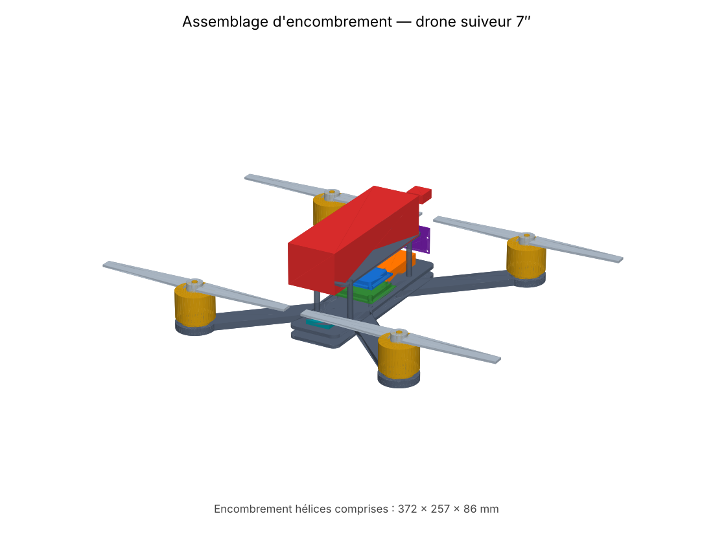
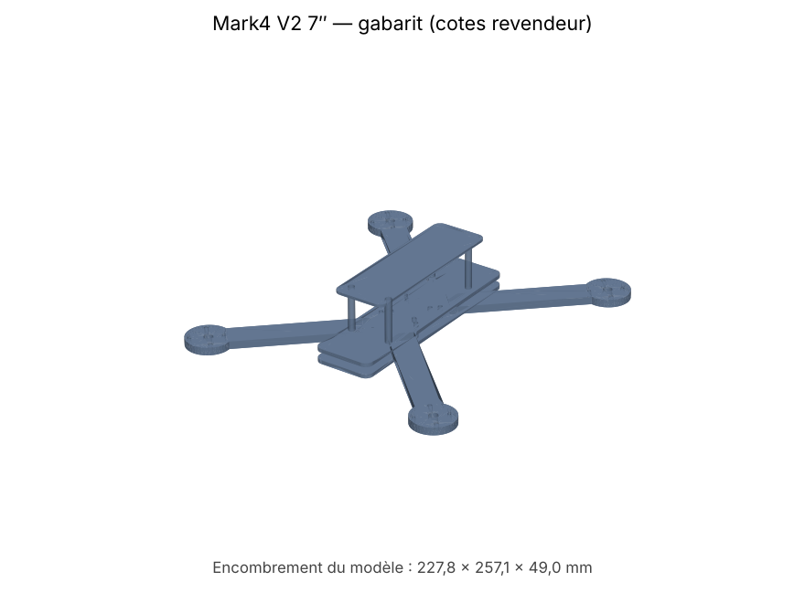
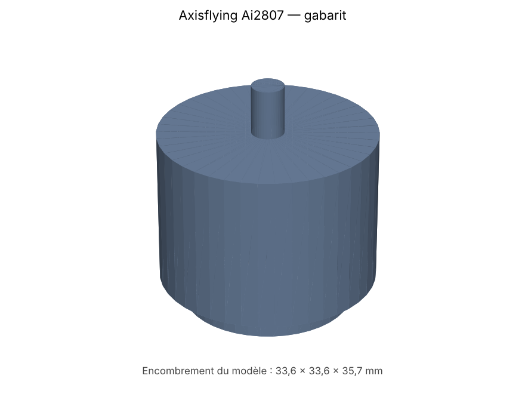
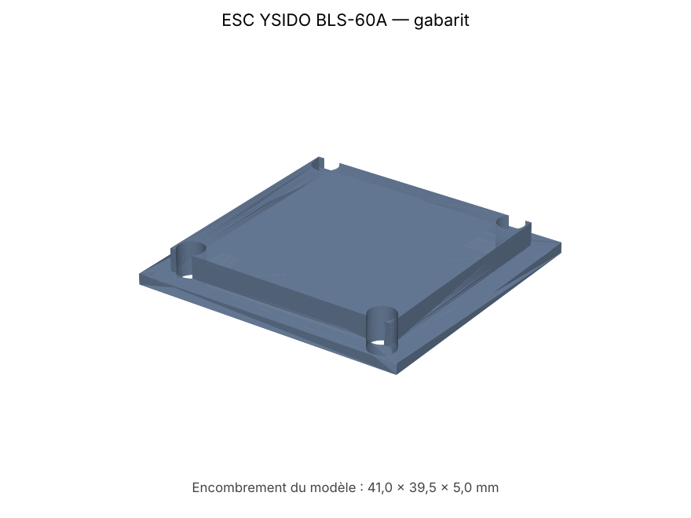
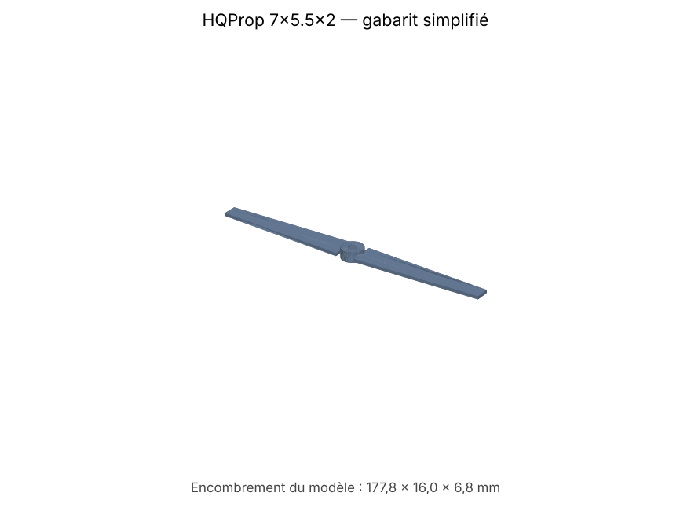
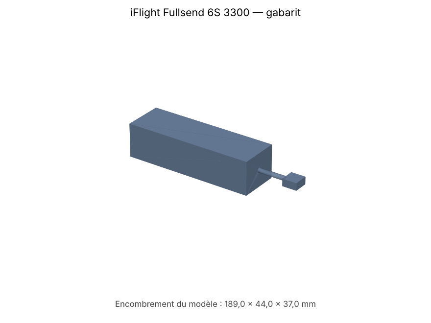
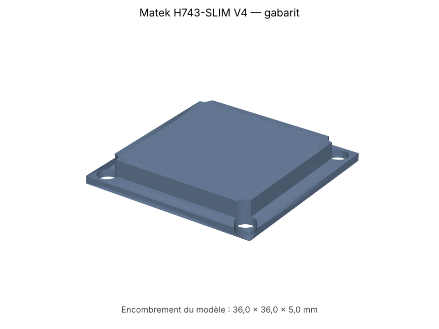
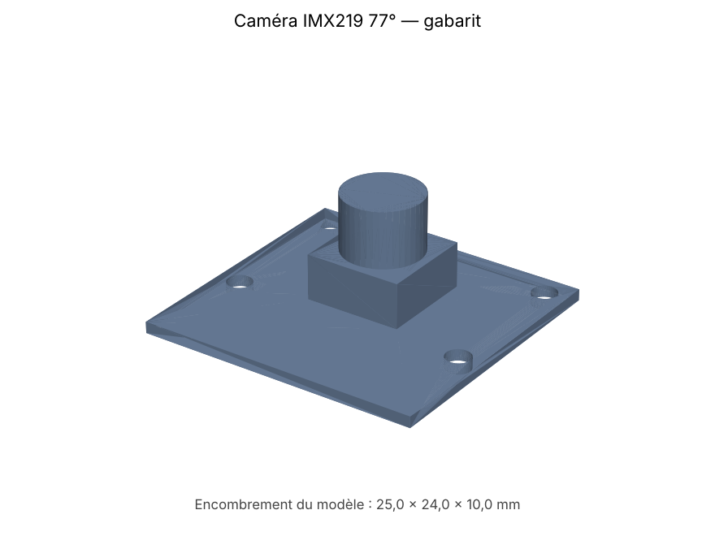
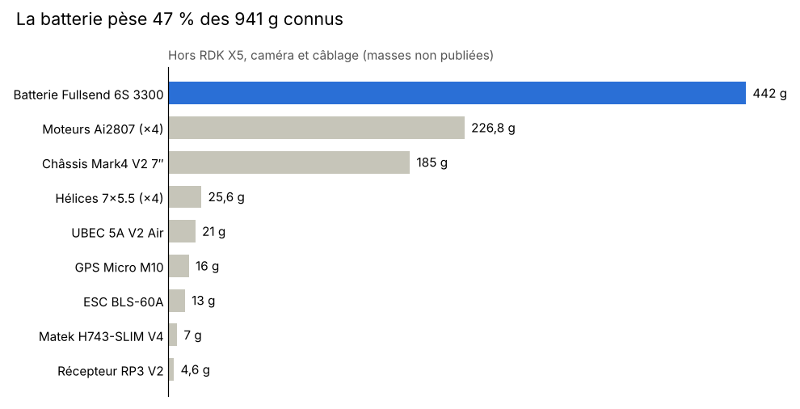

# Drone suiveur de cible — Rapport de séance : modélisation 3D
 
**Projet ROB Drone** · ROB3, Polytech Nice Sophia · Séance du 10 novembre 2026
 

 
## Objectif de la séance
 
Rassembler un modèle 3D (format STEP) pour chacun des 13 composants du drone 7″. Ces modèles servent à vérifier que tout rentre sur le châssis et à préparer la conception de la coque imprimée en 3D.
 
## Ce que j'ai fait
 
1. **Recherche des modèles 3D existants.** J'ai cherché, pour chaque composant, un fichier STEP ou 3MF publié par le fabricant ou par la communauté. Seuls trois composants en ont un officiel : la RDK X5 (D-Robotics), le GPS Micro M10 (Holybro) et, indirectement, le Matek (le STEP de la H7A3-SLIM a le même format que la H743-SLIM V4).
2. **Choix et modélisation du châssis.** Première piste : le TBS Source One V5 7″ DC, que j'ai reconstitué à partir des plans open source de TBS (modèle 3D des plaques + plan DXF des bras 7″). J'ai ensuite retenu un **Mark4 V2 7″** commandable sur AliExpress. Aucun plan n'existe pour ce clone : j'ai modélisé un gabarit à partir des cotes revendeurs.
3. **Gabarits d'encombrement paramétriques.** Pour les composants sans modèle 3D, j'ai écrit un script Python (bibliothèque [CadQuery](https://github.com/CadQuery/cadquery)) qui génère un volume simplifié à partir des cotes constructeur : enveloppe, trous de fixation, position de l'objectif.
4. **Vérification des cotes.** En comparant les fiches techniques, j'ai trouvé que le premier gabarit de l'ESC était faux (42 × 42 × 6 mm au lieu de 41 × 39,5 × 5 mm) et je l'ai corrigé.
5. **Assemblage.** J'ai placé tous les gabarits sur le châssis (image ci-dessus) : moteurs et hélices sur les bras, ESC et contrôleur de vol sur la pile 30,5 mm, batterie sur la plaque haute, caméra à l'avant.
6. **Fiches techniques et bilan de masse.** J'ai relevé les caractéristiques, les cotes et la masse de chaque composant.
## Résultats
 
### Modèles obtenus
 
| Composant | Cotes principales (mm) | Modèle 3D |
| --- | --- | --- |
| Châssis Mark4 V2 7″ | entraxe 295 ; moteurs sur 193,75 × 223,06 | Gabarit (cotes revendeur) |
| Moteurs Axisflying Ai2807 1300 KV (×4) | Ø33,6 × 35,7 | Gabarit |
| ESC 4-en-1 YSIDO BLS-60A | 41 × 39,5 × 5 ; fixation 30,5 | Gabarit |
| Hélices HQProp 7×5.5×2 (×4) | Ø177,8 ; moyeu Ø14 × 6,8 | Gabarit simplifié |
| Batterie iFlight Fullsend 6S 3 300 mAh | 141 × 44 × 37 | Gabarit |
| Contrôleur de vol Matek H743-SLIM V4 | 36 × 36 × 5 ; fixation 30,5 | Gabarit + STEP H7A3 officiel |
| Calculateur D-Robotics RDK X5 | 85 × 56 × 20 | [STEP officiel](https://archive.d-robotics.cc/downloads/hardware/rdk_x5/RDK_X5_LPDDR4_4266MHz_V1P0_pcb.stp) |
| Caméra IMX219 77° | 25 × 24 | Gabarit |
| GPS Holybro Micro M10 | 34 × 28 × 11 | [CAO officielle](https://docs.holybro.com/gps-and-rtk-system/m8n-m9n-m10-gps/micro-m10-m9n-gps/download) |
| Récepteur RadioMaster RP3 V2 | 22 × 13 × 4 | Gabarit |
| UBEC Hobbywing 5A V2 Air | 50 × 17 × 10 | Gabarit |
| Radiocommande RadioMaster Pocket | 156,6 × 65,1 × 125,3 | Gabarit (boîte) |
| Chargeur SkyRC B6 Neo | 70 × 50 × 32 | Gabarit (boîte) |
 
### Aperçu des modèles
 
| Châssis Mark4 V2 | Moteur Ai2807 | ESC BLS-60A | Hélice 7×5.5 |
| :---: | :---: | :---: | :---: |
|  |  |  |  |
| **Batterie 6S** | **Matek H743** | **Caméra IMX219** | |
|  |  |  | |
 
### Bilan de masse
 

 
Les composants embarqués dont la masse est connue font **941 g**. Avec la RDK X5, la caméra et le câblage, le drone devrait dépasser 1 kg au décollage. Les quatre moteurs fournissent jusqu'à 8,4 kg de poussée (4 × 2 095 g).
 
## Points de vigilance
 
- **Hélices** : entre les moteurs gauche et droite (193,75 mm), il ne reste que **16 mm** entre les bouts de pales. Avant/arrière (223,06 mm), il reste 45 mm.
- **RDK X5** : avec 56 mm de large, elle dépasse le corps du châssis (environ 47 mm). Il faudra un support au-dessus ou en dessous.
- **Fixation des moteurs** : le châssis accepte les motifs 16 × 16 et 19 × 19 mm. Les Ai2807 annoncent une cote de 19 mm : à confirmer sur les pièces.
- **Cotes du châssis** : elles varient d'un clone Mark4 à l'autre. Il faudra les mesurer à réception.
## Contenu du dépôt
 
```
drone-suiveur-modelisation-3d/
├── README.md                     ce rapport
├── images/                       rendus 3D et graphique de masse
└── cao/
    ├── assemblage_drone.step     assemblage complet (15 pièces)
    ├── assemblage.py             script qui génère l'assemblage
    ├── chassis/
    │   ├── Mark4_V2_7in_gabarit.step
    │   └── mark4.py              script du châssis (cotes en tête de fichier)
    └── gabarits/
        ├── *.step                un gabarit par composant
        └── gabarits.py           script des gabarits (dictionnaire DIMS)
```
 
Les fichiers `.step` s'ouvrent dans Fusion 360, SolidWorks, FreeCAD ou Onshape.
 
## Régénérer les modèles
 
Après avoir mesuré les pièces reçues, il suffit de corriger les cotes dans les scripts puis de relancer :
 
```bash
pip install cadquery
python cao/gabarits/gabarits.py cao/gabarits
python cao/chassis/mark4.py cao/chassis/Mark4_V2_7in_gabarit.step
python cao/assemblage.py cao cao/assemblage_drone.step images/assemblage.png
```
 
## Prochaines étapes
 
- Télécharger les modèles officiels de la RDK X5 et du GPS et les ajouter à l'assemblage.
- Mesurer les composants à réception et mettre à jour les gabarits.
- Concevoir la coque et le support de la RDK X5 autour de l'assemblage, pour impression 3D en PETG.
## Sources
 
- Mark4 V2 7″ : fiches [RCDrone](https://rcdrone.top/products/rcdrone-mark4-v2-fpv-frame-kit) et [VegaDrones](https://vegadrones.in/?p=1985)
- TBS Source One V5 : [plans officiels TBS](https://github.com/tbs-trappy/source_one)
- Axisflying Ai2807 : [fiche RCDrone](https://rcdrone.top/products/axisflying-ai2807-1300kv-4-6s-brushless-motor)
- ESC YSIDO BLS-60A : [notice](https://manuals.plus/ae/1005006633673995)
- iFlight Fullsend 6S : [fiche iFlight](https://shop.iflight.com/Fullsend-6S-3300mAh-95C-Battery-Pro1912)
- Matek H743-SLIM V4 : [page Matek](https://www.mateksys.com/?p=12864)
- RDK X5 : [fiche Waveshare](https://www.waveshare.com/rdk-x5.htm)
- Caméra IMX219 77° : [fiche RCDrone](https://rcdrone.top/products/yahboom-rdk-mipi-camera)
- GPS Micro M10 : [documentation Holybro](https://docs.holybro.com/gps-and-rtk-system/m8n-m9n-m10-gps/micro-m10-m9n-gps/overview)
- RadioMaster RP3 V2 : [fiche BuddyRC](https://www.buddyrc.com/products/radiomaster-rp3-expresslrs-2-4ghz-nano-receiver)
- UBEC Hobbywing : [fiche Hobbywing](https://www.hobbywingdirect.com/products/ubec-5a-air)
- SkyRC B6 Neo : [fiche Progressive RC](https://progressiverc.com/products/skyrc-b6neo)
