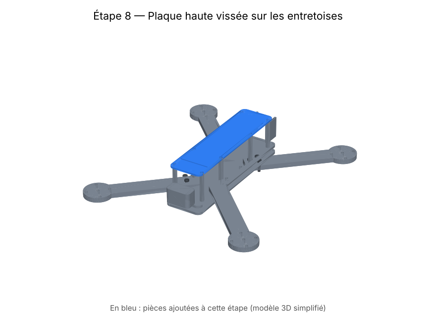
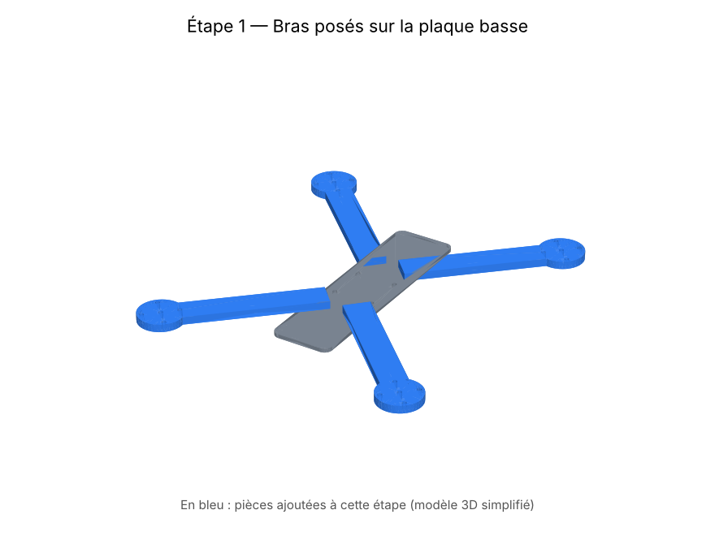
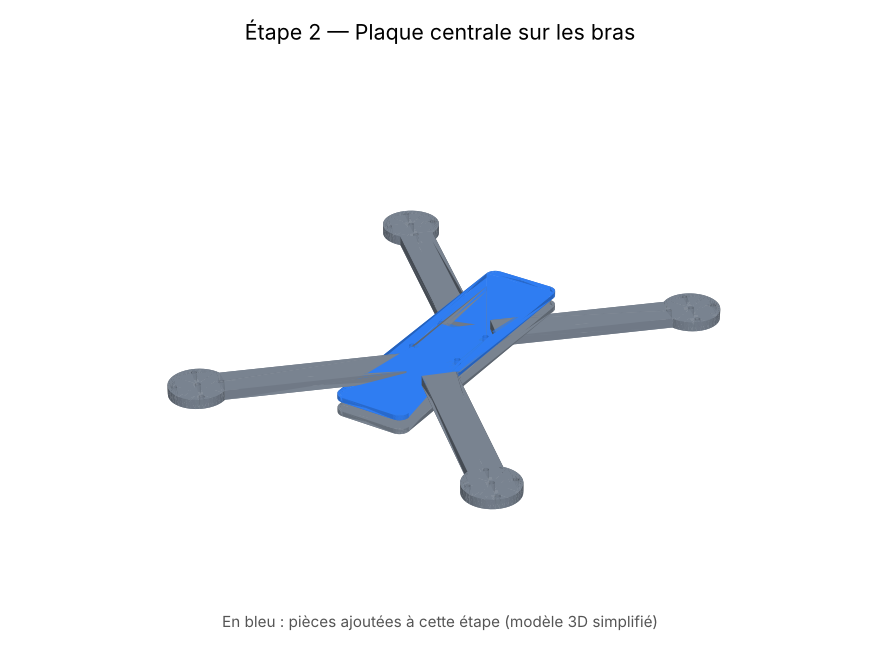
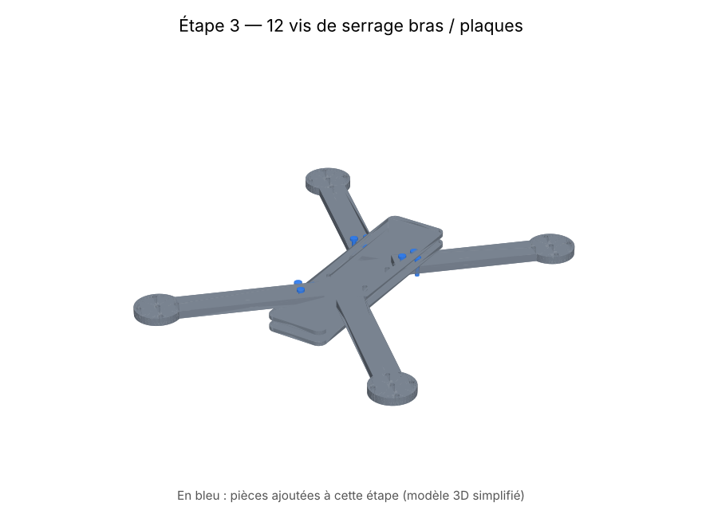
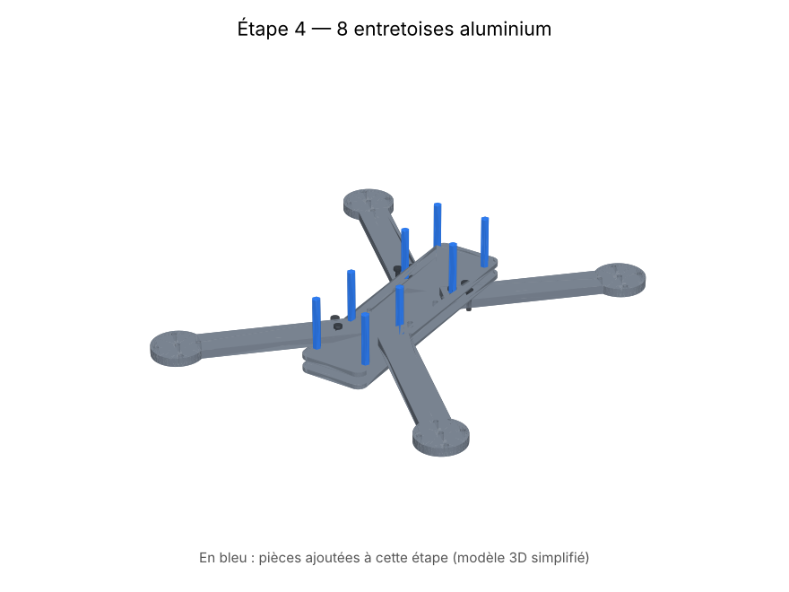
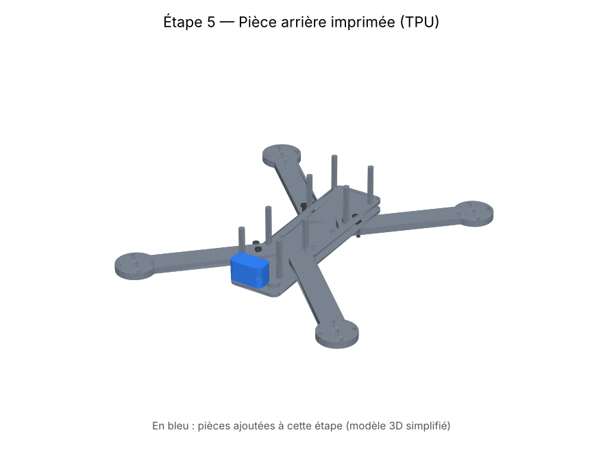
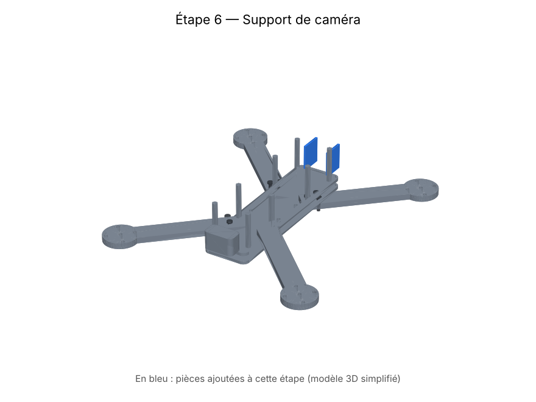
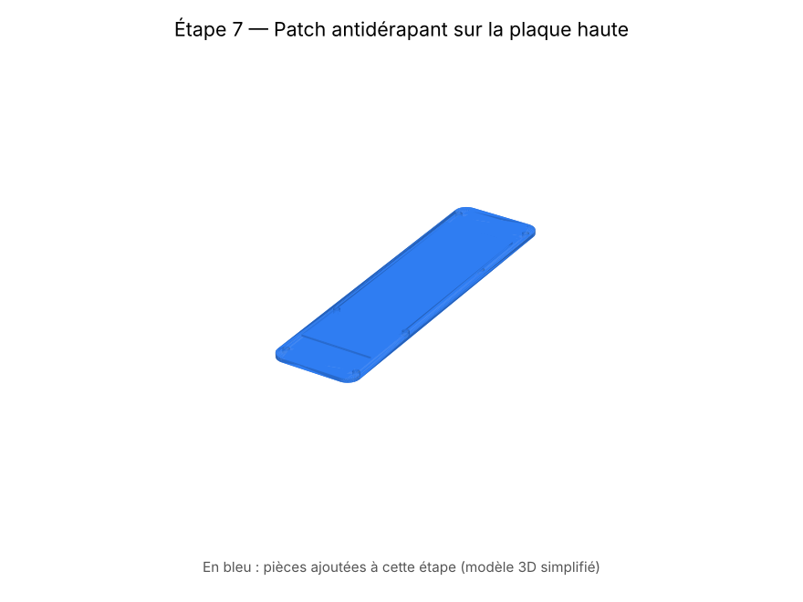

# Drone suiveur de cible — Rapport de séance : assemblage du châssis

**Projet ROB Drone** · ROB3, Polytech Nice Sophia · Séance du 24 novembre 2026

## Objectif de la séance

Assembler le châssis carbone **Mark4 V2 7″** (entraxe 295 mm) reçu d'AliExpress, en suivant la notice du fabricant, pour préparer l'installation de l'électronique à la séance suivante.

## Matériel et outils

| Élément | Détail |
| --- | --- |
| Kit châssis | plaque basse, plaque centrale, plaque haute, 4 bras, support de caméra, pièce arrière imprimée, patch batterie, sangles |
| Visserie du kit | 12 vis bras / plaques, 8 entretoises aluminium, 8 vis de plaque haute |
| Outils | clés hexagonales, clé à écrous, frein-filet moyen, papier de verre fin |
| Référence | [notice Mark 4-7 V2](https://manuals.plus/m/16af5ea550cfa2730f4f050e69de8f62a8df8944809ca56453f2c5b0f957ed32) (PDF : [lien direct](https://manuals.plus/m/16af5ea550cfa2730f4f050e69de8f62a8df8944809ca56453f2c5b0f957ed32.pdf)) |

Avant de commencer, j'ai sorti toutes les pièces et trié les vis par longueur, comme le conseille le [manuel Mark4 V2 de Rotorama](https://www.rotorama.com/assets/docs/c91315e3d5755d7290fdeb3eaea7ad88/45924-1/manual-mark4-10-v2-en.pdf). J'ai aussi poncé légèrement les bords tranchants des pièces en carbone : la poussière de carbone est irritante, il faut poncer à l'eau ou porter un masque.

> Les images de ce rapport sont des rendus du modèle 3D simplifié du châssis. Les pièces ajoutées à chaque étape sont en bleu. Pour les illustrations du fabricant, voir la notice citée à chaque étape.

<!-- Pour ajouter tes propres photos : dépose-les dans images/seance_03/ puis ajoute une ligne
      sous l'étape concernée. -->

---

## Étape 1 — Poser les bras sur la plaque basse

J'ai posé les quatre bras sur la plaque basse, en alignant leurs trous de fixation avec ceux de la plaque.

**Point d'attention :** vérifier que les bras sont symétriques (même longueur de chaque côté) avant de serrer quoi que ce soit.

📖 *Référence : notice Mark 4-7 V2, première figure du montage (« place the four arms onto the base plate »).*

## Étape 2 — Poser la plaque centrale

J'ai placé la plaque centrale par-dessus les bras, de façon à prendre les bras en sandwich entre les deux plaques. Tous les trous doivent être alignés.

📖 *Référence : notice Mark 4-7 V2, figure 2 (plaque centrale alignée sur les bras).*

## Étape 3 — Visser l'ensemble bras / plaques (12 vis)

J'ai fixé la plaque basse, les bras et la plaque centrale avec les **12 vis** prévues. J'ai d'abord approché toutes les vis, puis je les ai serrées progressivement en croix, pour que les bras restent bien en place et que les plaques ne travaillent pas.

**Point d'attention :** une vis doit prendre l'écrou sur toute la longueur de son filetage, sans dépasser dans l'espace où passeront les câbles.

📖 *Référence : notice Mark 4-7 V2, figure 3 (« secure with 12 screws ») · conseil de serrage en croix : [manuel Mark4 V2, §3](https://www.rotorama.com/assets/docs/c91315e3d5755d7290fdeb3eaea7ad88/45924-1/manual-mark4-10-v2-en.pdf).*

## Étape 4 — Monter les 8 entretoises aluminium

J'ai vissé les **8 entretoises aluminium** sur la plaque centrale, aux emplacements indiqués par la notice. Je les ai montées avec du frein-filet moyen, pour qu'elles ne se dévissent pas avec les vibrations.

📖 *Référence : notice Mark 4-7 V2, figure des entretoises (« install the eight aluminum posts ») · frein-filet sur les entretoises : [manuel Mark4 V2, conseils](https://www.rotorama.com/assets/docs/c91315e3d5755d7290fdeb3eaea7ad88/45924-1/manual-mark4-10-v2-en.pdf).*

## Étape 5 — Monter la pièce arrière imprimée

J'ai installé la pièce imprimée à l'arrière du châssis. Elle sert habituellement de support pour l'émetteur vidéo et les antennes.

📖 *Référence : notice Mark 4-7 V2, figure de la pièce arrière (« tail print »).*

## Étape 6 — Monter le support de caméra

J'ai fixé les deux flancs du support de caméra à l'avant du châssis. Ce support est prévu pour une caméra FPV de 19 mm de large : il faudra vérifier si la caméra IMX219 de la RDK X5 s'y adapte ou s'il faut imprimer un support spécifique.

📖 *Référence : notice Mark 4-7 V2, figure du support de caméra (« lens clamp »).*

## Étape 7 — Coller le patch batterie sur la plaque haute

J'ai collé le patch antidérapant sur la plaque haute, en alignant ses découpes sur les trous de la plaque. Les fraisages des trous de vis doivent être tournés vers le haut, pour que les têtes de vis ne dépassent pas sous la batterie.

📖 *Référence : notice Mark 4-7 V2, figure de la plaque haute (« battery sticker », trous fraisés vers le haut).*

## Étape 8 — Fixer la plaque haute

J'ai posé la plaque haute sur les entretoises et je l'ai fixée avec les **8 vis**. Je n'ai pas mis de frein-filet sur ces vis : la plaque devra être retirée à la prochaine séance pour installer l'électronique (ESC, contrôleur de vol, récepteur).

📖 *Référence : notice Mark 4-7 V2, dernière figure (« fasten the upper plate with eight screws ») · pas de frein-filet sur la plaque haute : [manuel Mark4 V2, conseils](https://www.rotorama.com/assets/docs/c91315e3d5755d7290fdeb3eaea7ad88/45924-1/manual-mark4-10-v2-en.pdf).*

---

## Contrôle final

- [x] Toutes les vis sont serrées et les bras n'ont aucun jeu.
- [x] Les bras sont symétriques.
- [x] Aucun bord de carbone tranchant à l'endroit où passeront les câbles.
- [ ] Mesurer l'entraxe réel (295 mm annoncés) et comparer avec le modèle 3D.

<!-- Problèmes rencontrés pendant la séance : à compléter (vis manquante, pièce différente de la notice, etc.). -->

## Prochaine séance

Installation de l'électronique sur le châssis :
- moteurs Axisflying Ai2807 sur les bras, avec des vis assez courtes pour ne pas toucher les bobinages ;
- pile ESC 4-en-1 + contrôleur Matek H743-SLIM V4 sur les silentblocs, flèche du contrôleur vers l'avant ;
- récepteur, GPS, UBEC et support de la RDK X5, plus large que le corps du châssis ;
- vérification du sens de rotation des moteurs **sans hélices**, hélices montées en dernier.

## Sources

- Notice de montage du Mark 4-7 V2 : [manuals.plus](https://manuals.plus/m/16af5ea550cfa2730f4f050e69de8f62a8df8944809ca56453f2c5b0f957ed32)
- Manuel du Mark4 10″ V2 (même famille, conseils de montage détaillés) : [Rotorama](https://www.rotorama.com/assets/docs/c91315e3d5755d7290fdeb3eaea7ad88/45924-1/manual-mark4-10-v2-en.pdf)
- Guide de montage d'un drone 7″ sur clone Mark4 : [Zelpio](https://zelpio.com/blog/build-7-inch-fpv-drone-guide/)
- Images : rendus du modèle 3D du châssis réalisé en séance 02 (script `etapes_mark4.py`)
