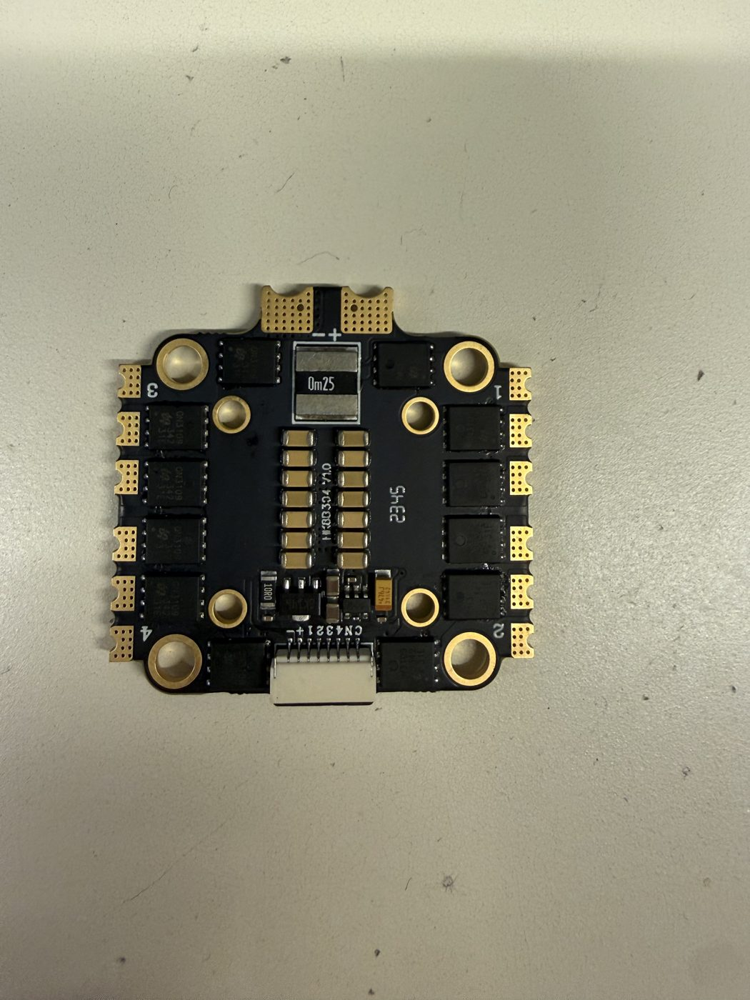
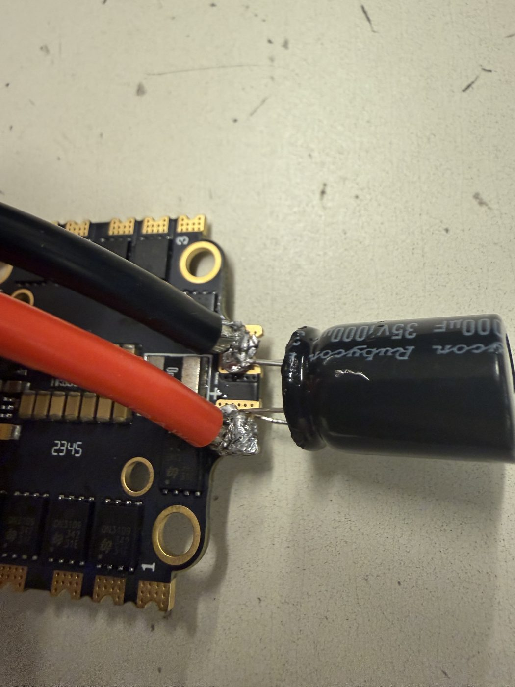
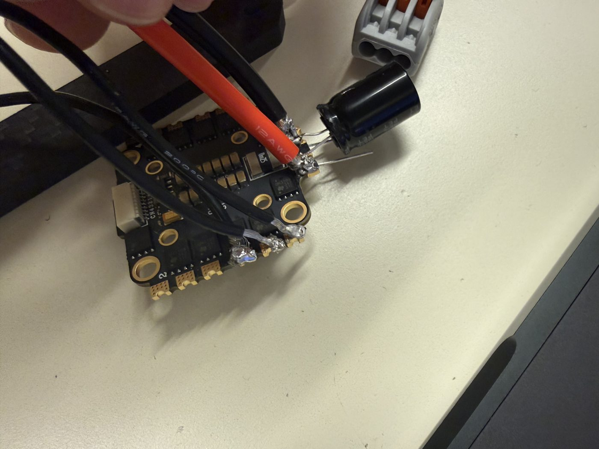
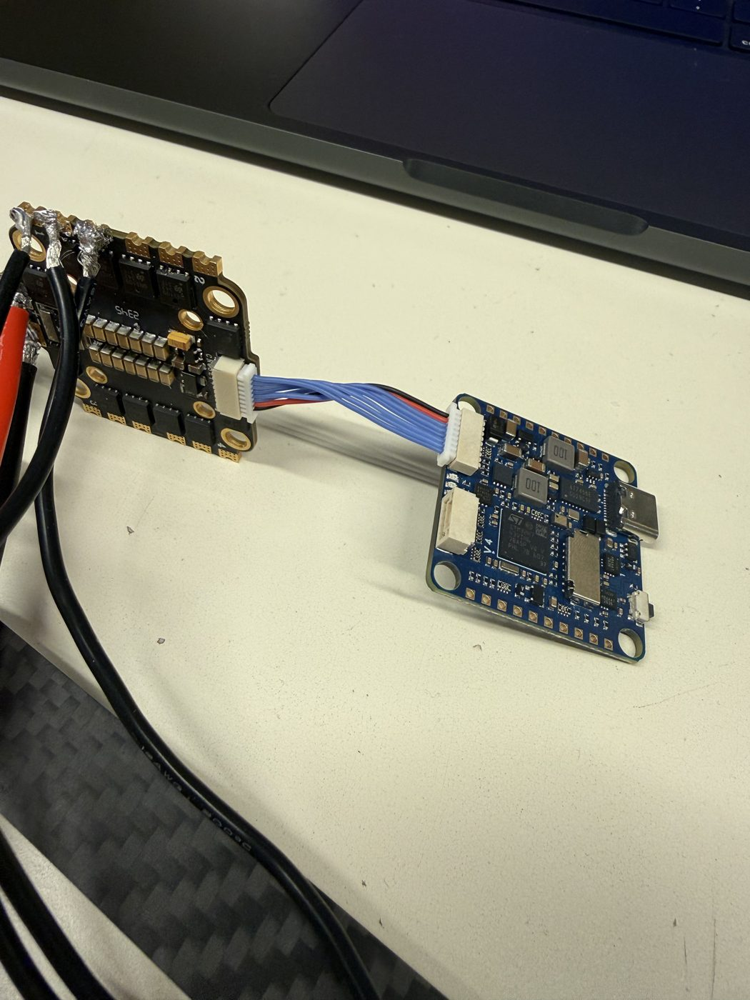
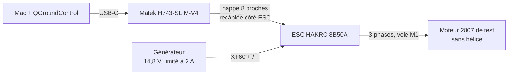
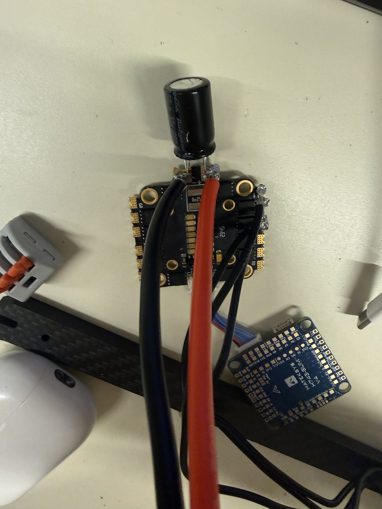

# Rapport de séance : 17 novembre 2026

**Projet :** BASTARD (drone intercepteur anti-UAS)
**Sujet :** séance d'entraînement sur un ESC et un moteur de substitution (le matériel définitif n'est pas encore arrivé)
**Auteur :** Mikael Masson

---

## 1. Contexte et objectif

L'ESC prévu dans la nomenclature, le **YSIDO BLS-60A 4-en-1**, n'était pas encore livré. Les moteurs **Axisflying AI2807 1300 KV** non plus.

Plutôt que d'attendre, la séance a servi d'**entraînement sur du matériel équivalent**. Le but était de maîtriser chaque geste avant de toucher aux pièces définitives :

1. Vérifier qu'un ESC disponible au labo, le **HAKRC 8B50A**, peut remplacer le BLS-60A pour des essais.
2. S'entraîner aux soudures de puissance : fils 12 AWG, condensateur, phases moteur.
3. Comprendre le raccordement ESC ↔ contrôleur de vol Matek H743-SLIM-V4 par la nappe 8 broches.
4. Préparer la procédure de banc d'essai : réglages ArduPilot, mise sous tension, test moteur.

> Il s'agit d'une **séance de test**. Le matériel utilisé ne sera pas forcément celui du drone final. En revanche, la méthode, les réglages et les erreurs relevées serviront directement au montage définitif.

## 2. Matériel

| Élément | Détail | Statut |
|---|---|---|
| ESC 4-en-1 | HAKRC 8B50A, BLHeli_S, 2–6S, 50 A continus / 60 A en pointe par voie | Substitut du YSIDO BLS-60A |
| Moteur | Brushless 2807 du labo (pas celui du projet) | Moteur d'entraînement |
| Contrôleur de vol | Matek H743-SLIM-V4, ArduCopter 4.7.2 (flashé le 6 novembre) | Définitif |
| Condensateur | Rubycon 1000 µF 35 V, électrolytique | Définitif |
| Fils de puissance | Silicone 12 AWG, rouge et noir | Définitif |
| Connecteur | XT60H-M (mâle, côté drone) | Définitif |
| Nappe | JST-SH 1,0 mm, 8 broches, livrée avec le Matek | À recâbler |
| Alimentation | Générateur (alimentation de labo) | — |
| Outillage | Fer à souder, flux, étain, multimètre Metrix MX 5006 | — |
| Poste | MacBook Pro, QGroundControl v5.1 | — |

## 3. Compatibilité de l'ESC de substitution

Avant de souder, on a comparé le HAKRC 8B50A au YSIDO BLS-60A prévu dans le rapport bibliographique.

| Critère | YSIDO BLS-60A (prévu) | HAKRC 8B50A (utilisé) | Conclusion |
|---|---|---|---|
| Tension | 2–6S | 2–6S | ✅ Compatible avec la Fullsend 6S |
| Courant par voie | 60 A continus, 70 A pendant 5 s | 50 A continus, 60 A en pointe | ✅ Marge suffisante (moteurs < 40 A en pointe), mais réduite de ~50 % à ~25 % |
| Firmware | BLHeli_S (EFM8BB21) | BLHeli_S, GH30-Rev16.7 | ✅ Même famille, DShot 150/300/600 |
| Fixation | 30,5 × 30,5 mm | 30,5 × 30,5 mm | ✅ Compatible avec le Matek |
| Dimensions / masse | env. 45,6 × 44 mm, 13 g | 38,5 × 41 mm, 12,5 g | ✅ Rentre dans l'enveloppe STEP prévue |
| Capteur de courant | Oui | Oui (shunt « 0m25 ») | ✅ Facteur HAKRC 160, soit `BATT_AMP_PERVLT = 62,5` dans ArduPilot |
| BEC | Non | Non | — |

**Conclusion :** le HAKRC convient pour le banc d'essai et pourrait même dépanner sur le drone. Avec une marge en courant plus faible, il faudra alors soigner le refroidissement dans la monocoque.

## 4. Déroulé

### 4.1 Lecture du brochage des connecteurs

Le connecteur JST-SH 8 broches de l'ESC a une sérigraphie **imprimée à l'envers**. Après agrandissement de la photo, l'ordre relevé est le suivant, connecteur tourné vers soi, de gauche à droite :

| Côté ESC (HAKRC) | − | + | 1 | 2 | 3 | 4 | N | C |
|---|---|---|---|---|---|---|---|---|
| Fonction | Masse | Batterie | Signal M1 | Signal M2 | Signal M3 | Signal M4 | Non relié | Courant |

La fiche Matek donne pour son connecteur l'ordre **Vbat / G / Curr / Rx8 / S1 / S2 / S3 / S4**.

**→ Les deux ordres sont différents : la nappe ne peut pas être utilisée fil à fil.**

### 4.2 Soudures de puissance

Méthode suivie :

1. Étamage des pastilles et des fils avant assemblage, avec du flux.
2. Fil noir 12 AWG sur la pastille **−**, fil rouge sur la pastille **+**. La polarité est sérigraphiée au-dessus de la résistance de mesure « 0m25 ».
3. Condensateur 1000 µF 35 V soudé sur les mêmes pastilles, pattes courtes.
4. Borne XT60H-M soudée à l'autre bout pour le raccordement au générateur. Le capuchon est enfilé avant soudure et le connecteur est branché sur une femelle pour garder les broches alignées.

**Contrôle visuel :**
- ✅ Polarité des fils de puissance correcte.
- ⚠️ Soudures d'aspect granuleux et terne, ce qui peut indiquer une soudure froide. À refaire avec du flux, vers 380–400 °C.
- ⚠️ Une patte du condensateur dépasse loin après la soudure : à couper et à isoler avec de la gaine thermorétractable.
- ⚠️ Sens du condensateur (bande −) à reconfirmer côté fil noir.

### 4.3 Soudure du moteur sur la voie M1

Les trois phases du moteur sont soudées sur les pastilles de la **voie M1**, à côté de l'arrivée de puissance. Les fils sont posés dans l'ordre extérieur → extérieur, intérieur → intérieur, pour qu'ils ne se croisent pas. L'ordre des phases ne change que le sens de rotation.

**Contrôle visuel :**
- ✅ Phases sur la bonne voie.
- ⚠️ Brins de cuivre qui dépassent sur une soudure : risque de court-circuit avec la pastille voisine. À couper ou à refaire.

### 4.4 Raccordement au Matek

Le Matek n'a **besoin d'aucune soudure** pour ce montage : il se relie à l'ESC uniquement par la nappe 8 broches.

La nappe a d'abord été branchée **fil à fil**, telle que livrée. Comparée aux brochages de la section 4.1, cela donne :

| Fil côté Matek | Arrive côté ESC sur | Conséquence à la mise sous tension |
|---|---|---|
| Vbat | − (ou une broche signal) | ❌ Inversion d'alimentation |
| G | + (ou une broche signal) | ❌ Le Matek grille |

**→ Aucune mise sous tension de puissance n'a été faite.** Seul l'USB a été envisagé, ce qui ne présente aucun risque puisque la nappe ne porte alors aucune tension batterie.

**Recâblage à faire sur la prise côté ESC uniquement** (la prise côté Matek reste d'origine) :

| Fil côté Matek | Nouvelle broche côté ESC |
|---|---|
| Vbat | **+** |
| G | **−** |
| S1 | 1 |
| S2 | 2 |
| S3 | 3 |
| S4 | 4 |
| Curr | C |
| Rx8 | N (ou fil retiré) |

Méthode : soulever l'ergot de chaque contact avec une aiguille fine, sortir le fil, le réinsérer dans le bon trou, puis tirer légèrement pour vérifier qu'il tient. Un fil à la fois.

### 4.5 Procédure préparée pour la prochaine séance

**Contrôles au multimètre** (tout débranché, nappe recâblée et branchée des deux côtés) :

| Mesure | Attendu |
|---|---|
| Vbat Matek ↔ + ESC | Bip |
| G Matek ↔ − ESC | Bip |
| Vbat Matek ↔ − ESC | Pas de bip |
| + ESC ↔ − ESC | Valeur qui monte (charge du condensateur), jamais 0 Ω fixe |
| Chaque phase moteur ↔ − ESC | Pas de bip |

**Paramètres ArduPilot** (QGroundControl, USB seul, puis redémarrage) :

| Paramètre | Valeur | Rôle |
|---|---|---|
| `FRAME_CLASS` | 1 | Quadricoptère |
| `FRAME_TYPE` | 1 | Configuration X |
| `MOT_PWM_TYPE` | 6 | DShot600 |
| `SERVO_DSHOT_ESC` | 2 | Commandes BLHeli_S / Bluejay |
| `SERVO_BLH_AUTO` | 1 | Passthrough vers l'ESC |
| `BRD_SAFETY_DEFLT` | 0 | Pas de bouton de sécurité sur le Matek |
| `BATT_AMP_PERVLT` | 62,5 | 10 000 / 160 (facteur HAKRC) |

**Ordre de mise sous tension :** USB d'abord → générateur réglé à 14,8 V et limité à 2 A → sortie allumée en surveillant le courant (plus de 0,5 A au repos : couper) → mélodie de démarrage puis bip d'armement → test moteurs dans QGroundControl à 5 %, puis 10 %.

## 5. Problèmes rencontrés et solutions

| Problème | Cause | Solution |
|---|---|---|
| ESC prévu (YSIDO BLS-60A) non livré | Délai de livraison | Entraînement sur un HAKRC 8B50A équivalent (section 3) |
| Sérigraphie du connecteur ESC illisible | Texte imprimé à l'envers, caractères de 1 mm | Photo agrandie, puis confirmation au multimètre |
| Nappe livrée incompatible fil à fil | Ordres des broches différents entre Matek et HAKRC | Recâbler la prise côté ESC (section 4.4) |
| Soudures de puissance d'aspect froid | Chauffe insuffisante pour du 12 AWG sur une grosse pastille | Reprendre avec du flux, à 380–400 °C |
| Brins dépassants sur une phase moteur | Fil mal étamé avant soudure | Couper les brins, ou étamer puis ressouder |
| Patte de condensateur trop longue | Pas recoupée après soudure | Couper au ras et isoler avec de la gaine |

## 6. Bilan

| Point | Résultat |
|---|---|
| Compatibilité ESC de substitution | ✅ Validée |
| Soudure des fils de puissance | ✅ Faite, ⚠️ à reprendre (aspect froid) |
| Soudure du condensateur | ✅ Faite |
| Soudure de la borne XT60H-M | ✅ Faite |
| Soudure du moteur sur la voie M1 | ✅ Faite, ⚠️ brins à nettoyer |
| Nappe ESC ↔ Matek | ❌ À recâbler avant toute mise sous tension |
| Mise sous tension et test moteur | ⏳ Pas faits (volontairement) |

**Conclusion :** la séance a atteint son but d'entraînement. Les gestes de soudure de puissance sont acquis, mais leur qualité reste à améliorer. Surtout, une **erreur qui aurait détruit le contrôleur de vol** (la nappe fil à fil) a été repérée **avant** la mise sous tension. Cette vérification fera partie de la procédure du montage définitif avec le YSIDO BLS-60A, dont le brochage devra être relevé de la même façon.

## 7. Reste à faire

- [ ] Reprendre les deux soudures de puissance (flux, 380–400 °C)
- [ ] Couper et isoler les pattes du condensateur, confirmer la bande − côté fil noir
- [ ] Nettoyer les brins dépassants sur la phase moteur
- [ ] Recâbler la prise côté ESC de la nappe
- [ ] Contrôles au multimètre (section 4.5)
- [ ] Régler les paramètres ArduPilot, puis redémarrer
- [ ] Mise sous tension sur générateur limité en courant et test moteurs à 5 puis 10 %
- [ ] S'entraîner à inverser le sens de rotation (croisement de deux phases, ou `SERVO_BLH_RVMASK`)
- [ ] À la réception du YSIDO BLS-60A : relever son brochage et refaire la même vérification de nappe
- [ ] Mettre à jour `Cotes_composants_STEP.md` si le HAKRC est conservé (38,5 × 41 mm, 12,5 g)

## Références

- Notice HAKRC 8BIT/32BIT 4-in-1 ESC : https://manuals.plus/ae/1005005956508797
- Matek H743-SLIM-V4 (brochage du connecteur ESC) : https://www.mateksys.com/?p=12864
- ArduPilot, Mateksys H743-Wing/SLIM : https://ardupilot.org/copter/docs/common-matekh743-wing.html
- ArduPilot, ESC BLHeli32, AM32 et BLHeli_S (passthrough) : https://ardupilot.org/copter/docs/common-blheli32-passthru.html
- ArduPilot, ESC DShot : https://ardupilot.org/copter/docs/common-dshot-escs.html
- Guide du banc d'essai rédigé pendant la séance : https://claude.ai/artifact/DwnaYruP8dKDSWCPfmDBHt
